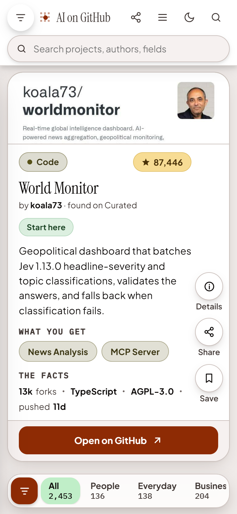

# AI on GitHub

### A catalogue of what people are building with AI, sorted by what each project is for.

**[aiongithub.com](https://aiongithub.com)**

 

 

## What it is

Thousands of AI projects ship every month, and a list of repository names tells you nothing. AI on GitHub reads each
project and files it by the job it does, so you can answer one question quickly: **what already exists for the thing
I am trying to do?**

More than 2,400 projects are in the catalogue today.

## What you can do

| You want to | How |
|---|---|
| Browse by purpose | Six fields: People, Everyday, Business, Reach, Engineering, Making |
| Narrow it down | Filter by family, capability, source, type or creator |
| Find something specific | Search projects, authors and fields |
| See what is rising | Sort by Top, Most stars, Newest or A to Z |
| Judge a project in seconds | Each card says what the project does, what you get, and the facts: stars, forks, language, licence, last push |
| Add one | Paste a link from X, GitHub, Reddit, YouTube, npm or anywhere else |

<table>
<tr>
<td width="62%" valign="top">

**On a desktop: compare**

A grid of cards with every filter beside it.

</td>
<td width="38%" valign="top">

**On a phone: judge**

One project per screen. Swipe to the next.

</td>
</tr>
</table>

## About this repository

This is the public home of AI on GitHub: what it is, what it looks like, and where to send feedback.

| | |
|---|---|
| **The product** | [aiongithub.com](https://aiongithub.com) |
| **Feedback and requests** | Open an [issue](../../issues) |
| **To have a project removed** | [aiongithub.com/legal](https://aiongithub.com/legal) |
| **The source code** | Not published. This repository holds no application code |

## Independence

AI on GitHub is an independent project. It is not affiliated with, endorsed by, or sponsored by GitHub, Inc. or
Microsoft Corporation. GitHub is a trademark of GitHub, Inc. Project names and logos belong to their respective owners.

 

Built by Abbas Shaheer &nbsp;·&nbsp; © 2026, all rights reserved

