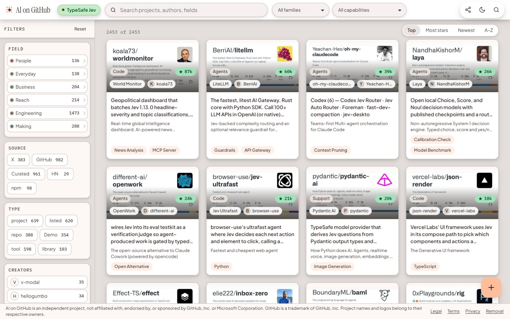
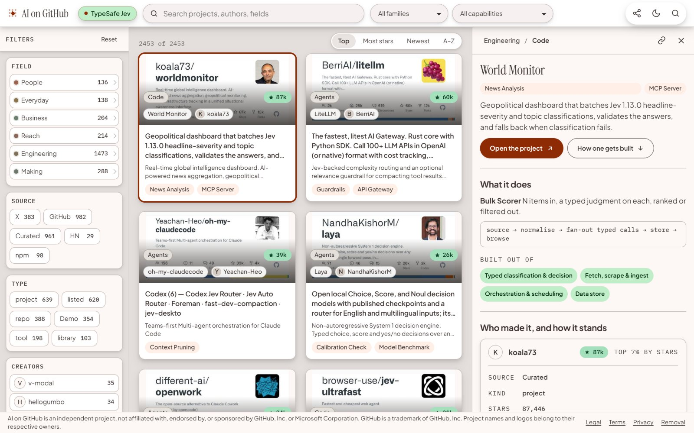
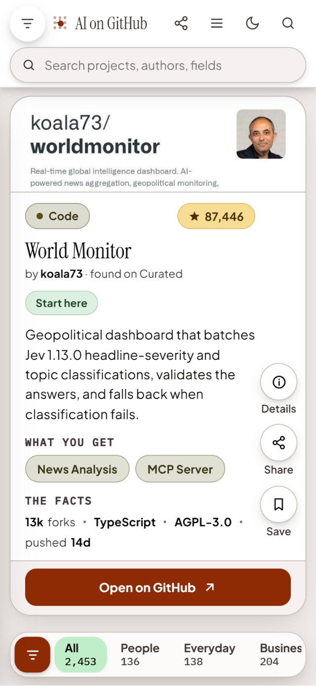
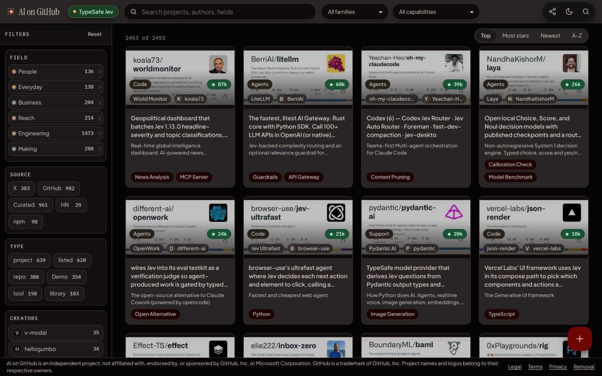
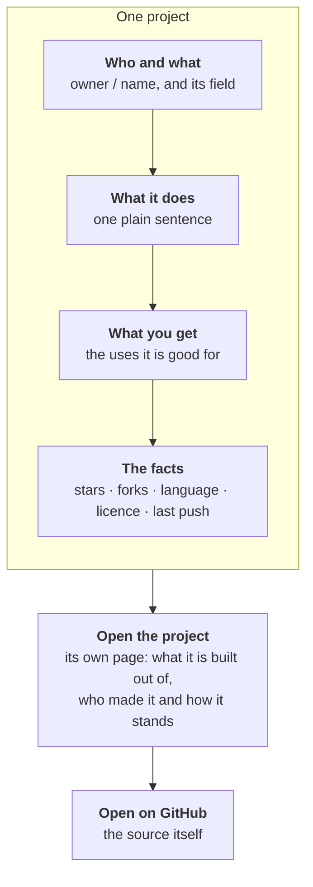

<div align="center">

<picture>
  <source media="(prefers-color-scheme: dark)" srcset="docs/images/logo-dark.svg">
  
</picture>

### What already exists for the thing you are trying to build?

**[aiongithub.com](https://aiongithub.com)**

2,453 shipped AI projects &nbsp;·&nbsp; filed by what each one is for &nbsp;·&nbsp; free to browse, nothing to install

[Open it](#open-it) &nbsp;·&nbsp; [Why it exists](#a-list-of-names-tells-you-nothing) &nbsp;·&nbsp; [What you can do](#what-you-can-do) &nbsp;·&nbsp; [How to read a card](#how-to-read-a-card) &nbsp;·&nbsp; [Add a project](#add-a-project) &nbsp;·&nbsp; [Questions](#questions)

<br>



</div>

<br>

## Open it

There is nothing to install and no account to make:

```text
https://aiongithub.com
```

Type what you are trying to build into the search box, or pick a field on the left.

## A list of names tells you nothing

Thousands of AI projects ship every month. They are announced in a post, starred for a week, and then buried under the next thousand.

When you sit down to build something, the question is never "what is popular?". It is:

> **Has somebody already solved a piece of this, and can I see how they did it?**

A list of repository names cannot answer that. You would have to open each one and read it.

AI on GitHub does that reading once, for everybody. Each project is opened, described in one plain sentence, and filed by the job it does and the parts it is built from.

| Searching by hand | With AI on GitHub |
|---|---|
| Names and star counts | One sentence on what the project does, and what you get from it |
| Sorted by popularity | Filed by purpose: who it is for and what job it does |
| One source at a time | GitHub, X, Hacker News, npm and hand-picked lists in one place |
| Open every repository to judge it | The facts on the card: stars, forks, language, licence, last push |
| No idea how it was built | The capabilities it is built from, named the same way on every project |

## What you can do

<table>
<tr>
<td width="62%" valign="top">

**Compare, on a desktop**

A grid of cards with every filter beside it. Open a project and its page slides in next to the grid, so you never lose your place.



</td>
<td width="38%" valign="top">

**Judge, on a phone**

One project per screen. Swipe to the next.

<p align="center"></p>

</td>
</tr>
</table>

| You want to | How |
|---|---|
| Browse by purpose | Six fields: **People**, **Everyday**, **Business**, **Reach**, **Engineering**, **Making** |
| Find projects built a certain way | Fifteen capabilities, from orchestration and data stores to browser automation, search, voice and image |
| Narrow it down | Filter by source, by type (project, repository, tool, library, demo) or by creator |
| Find something specific | Search projects, authors and fields |
| See what matters now | Sort by **Top**, **Most stars**, **Newest** or **A to Z** |
| Keep or pass on a find | Save a project, or share a link that opens straight on it |
| Work at night | A dark theme, one press away |



## How to read a card

Every project is described the same way, so that two of them can be compared in seconds.



| On the card | What it tells you |
|---|---|
| The field, top left | Who or what the project is for |
| The star count | How many people have marked it, to the nearest thousand |
| The first sentence | What it does, written for this catalogue, not copied from its README |
| The second sentence | How the project describes itself |
| The tags | What you get from it: the jobs it is good for |

## What is in it today

The catalogue opens with one collection, **TypeSafe Jev**: 2,453 shipped projects, each read, described and filed.

| Field | Projects | | Found through | Projects |
|---|---|---|---|---|
| Engineering | 1,473 | | GitHub | 982 |
| Making | 288 | | Curated lists | 961 |
| Reach | 214 | | X | 383 |
| Business | 204 | | npm | 98 |
| Everyday | 138 | | Hacker News | 29 |
| People | 136 | | | |

<sub>Counts as shown on the site on 11 October 2026. The site is the live number.</sub>

**Where it is going:** more collections beside the first, and from a catalogue towards a marketplace of AI tools and the parts they are built from, gathered from many sources. GitHub is the largest of them, which is where the name comes from.

## Add a project

| You want to | Do this |
|---|---|
| Add a project | Press **+** on the site and paste a link from GitHub, X, Reddit, YouTube, npm or anywhere else. Or [suggest it here](../../issues/new?template=add-project.yml) |
| Correct how a project is described | [Report a correction](../../issues/new?template=correction.yml) |
| Report something that does not work | [Report a problem](../../issues/new?template=problem.yml) |
| Have your project removed | [aiongithub.com/legal#removal](https://aiongithub.com/legal#removal) |

## Questions

<details>
<summary><b>Is it free? Do I need an account?</b></summary>
<br>
Browsing, searching and filtering need no account and no payment.
</details>

<details>
<summary><b>Is this made by GitHub?</b></summary>
<br>
No. It is an independent project. See <a href="#independence">Independence</a> below.
</details>

<details>
<summary><b>Who writes the descriptions?</b></summary>
<br>
Each description is written for the catalogue, not copied from the project. A description can be wrong: if one is, report a correction and say what the project really does.
</details>

<details>
<summary><b>My project is listed and I would rather it was not.</b></summary>
<br>
Use the removal page: <a href="https://aiongithub.com/legal#removal">aiongithub.com/legal#removal</a>.
</details>

<details>
<summary><b>Where is the code?</b></summary>
<br>
It is not published. This repository is the product's public home: what it is, how to use it, and where to send requests. It holds no application code.
</details>

## About this repository

| | |
|---|---|
| **The product** | [aiongithub.com](https://aiongithub.com) |
| **Requests, corrections and problems** | [Open an issue](../../issues/new/choose) |
| **Terms, privacy and removal** | [aiongithub.com/legal](https://aiongithub.com/legal) |
| **The source code** | Not published. See the [licence](LICENSE) |
| **Who makes it** | [Abbas Shaheer](https://github.com/syedabbasshaheer-art) |

## Independence

AI on GitHub is an independent project. It is not affiliated with, endorsed by, or sponsored by GitHub, Inc. or Microsoft Corporation. GitHub is a trademark of GitHub, Inc. Project names and logos belong to their respective owners.

<br>

<div align="center">
<sub>© 2026 Abbas Shaheer &nbsp;·&nbsp; all rights reserved</sub>
</div>
